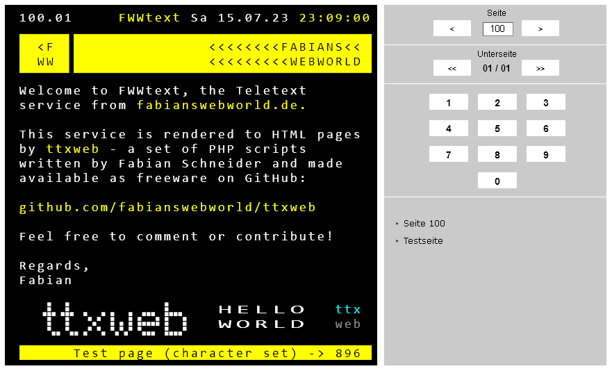
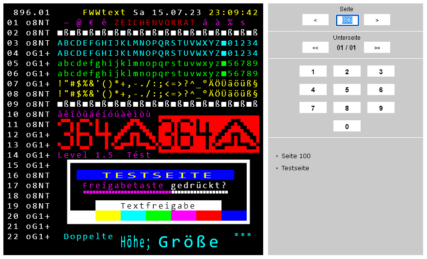
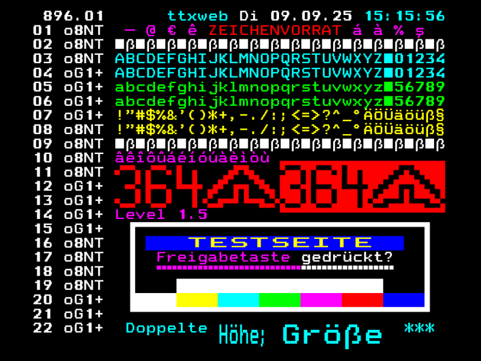

#   ttxweb - Teletext-to-HTML generator

## What is ttxweb?

ttxweb is a web application that brings the "old-fashioned" teletext (Videotext) to the web in a simple way. This is mostly interesting for broadcasters. All Level 1.0 teletext attributes such as flash and double height are supported; additionally, some Level 2.5 attributes (double width and double size) are supported. Decoding of enhanced Level 1.5 characters via packet X/26 is supported as well if they are carried inside the input file. On the generated HTML pages, page numbers (only references to existing pages) are automatically rendered as clickable hyperlinks. Similarly, "next" indicators such as ">>" and "->" are rendered as hyperlinks to the next subpage or page. Additionally, web links and email links are rendered as hyperlinks as well.

Another nice feature is that the pages can update automatically at a configurable refresh interval. The update happens smoothly via XMLHttpRequest (no full page reload), so that just the teletext portion of the page is reloaded.

To use ttxweb, all you have to do is install the PHP scripts including the additional files (CSS, JS etc.) on a web server and ensure that the teletext pages are synchronized as EP1, AST or TTI files in a configurable folder that can be accessed from the PHP script (e.g. via FTP).

## Live Demo

See the **live demo** at:

- https://www.fabianswebworld.de/ttxweb (English)
- https://www.fabianswebworld.de/fwwtext (German, as part of my blog)

See and try out the nice **'retro-tv'** template at:

- https://www.fabianswebworld.de/fwwtext/?template=retro-tv

Use the number keys to enter a page number, or the arrow keys to browse through pages (up/down=page numbers, left/right=subpages).

See it in **production use** at:

- https://www.hr-text.hr-fernsehen.de (Hessischer Rundfunk, hr-text)
- https://www.swrfernsehen.de/videotext/ (Südwestrundfunk, SWR-Text)

## Screenshots

## Installation

### Preparation

#### System requirements

A web server with PHP >= 5.6 is required. The PHP intl extension is recommended, but not required (English date formats are used as a fallback). There are _no_ other requirements (like MySQL etc.).

#### Input files

The teletext pages to be displayed must be in EP1 format (Softel), AST format (ASTET) or TTI format (MRG Systems). These file formats can be processed or exported by all common teletext systems (Softel, Broadstream etc.). If required, an adaptation to other formats (TTX, ETT, etc.) is possible with reasonable effort, as has already been done e.g. by Max de Vos with his great addition of the TTI parser in version 1.7.0 (thank you!). For EP1 files, the ttxweb EP1 parser will automatically detect the flavor of EP1 file: plain Level 1.0 files without X/26 data as well as both flavors of Softel EP1 files with X/26 data (Flair and TAP). Note: To enable X/26 export in the TAP process, you'll have to set the (undocumented) environment variable TRA_TAP_X26 to 1 on the Transmission machine which hosts TAP.EXE. For AST files, X/26 data is detected and decoded automatically as well, if it is included as a regular packet 26 inside the file (any packet/row order is possible).

The input files must be suitably synchronized to a folder accessible to the PHP script in the filename format PxxxSyy.EP1 by default (where xxx = page number, yy = subpage number). The file name format can be adjusted in the script if required.

Files with a size of 0 bytes (e.g. used as "deletion files" in some Sophora installations) are considered non-existent; corresponding pages are treated as non-existent pages, i.e. skipped.

#### Important notes

Historically, only the EP1 file format was supported by ttxweb, so the term "EP1 file" is used synonymously with "input file" in some places in the documentation and also throughout the code. This explains function names such as "getEp1Filename()" which is used to get the input filename. The same applies to a number of configuration parameter names starting with `EP1_`, which apply to multiple input file formats as well.

The file format actually used is inferred from the file extension given in the `EP1_PATTERN` option. Starting with version 1.7.0, thanks to the addition of the TTI file format parser by Max de Vos, ttxweb can read TTI files which normally contain multiple subpages inside one single file. For that reason, the %ss% (subpage) placeholder may be omitted from `EP1_PATTERN` if the `.tti` extension is used. Nevertheless, since version 1.10.0 it _is_ possible to use single-subpage TTI files by specifying a pattern using the `.tti` extension _and_ containing the `%ss%` placeholder, like `'P%ppp%S%ss%.tti'`.

**Non-standard file extensions (optional):** If your teletext exporter writes EP1, AST, or TTI files under a different extension (such as `.txt` or `.ttx`), you can optionally define `TTXWEB_FORMAT` as `'ep1'`, `'ast'`, or `'tti'` (case-insensitive) to force the corresponding parser regardless of the filename extension. Leave `TTXWEB_FORMAT` unset or empty to keep automatic extension detection.

**Upgrading from versions 1.7.0 - 1.9.0:** Previously, `TTXWEB_FORMAT` was included in the default config (`'ep1'` or `'tti'`), and `TTI_PATH` / `TTI_PATTERN` were used to configure TTI sources if `TTXWEB_FORMAT` was set to `'tti'`. Both `TTI_PATH` and `TTI_PATTERN` are now deprecated and removed from the example configuration, though they still work when `TTXWEB_FORMAT` is set to `'tti'` (if omitted, `EP1_PATH` and `EP1_PATTERN` are used instead). If you keep an older config file with `TTXWEB_FORMAT = 'ep1'` while serving `.ast` files, remove `TTXWEB_FORMAT` (or update it to `'ast'`), as `'ep1'` now would strictly force the EP1 parser.

### Deployment

The PHP script and all auxiliary files must be copied to the web server and configured according to the section below. The **g1.zip** file in the **g1** folder needs to be unzipped on the server (faster deployment than transferring 1024 separate files). The transfer of the EP1/AST/TTI/etc. input files must be set up. In order to prevent users from directly accessing the input files via the web server, the commented lines of the supplied .htaccess file in the ttxweb folder should be uncommented (as long as the server supports Rewrite Rules).

## Configuration and customizations

The following configuration options are available to configure the behavior of ttxweb and adapt the output to your own website design:

- **includes/ttxweb_config.php:**
  - const **TTXWEB_TEMPLATE** - Template name, i.e. folder to use for HTML templates; must be a subfolder in the **templates/** folder (default: 'default')
  - const **TTXWEB_REFRESH** - Seconds for automatic refresh via XHR (default: 0 = disabled)
  - const **TTXWEB_TURN_RATES** - Array of pages that should turn automatically, and how fast (example see file or below); in TTI file mode, the turn rates from the TTI files are used (more specifically: the first CT record from the TTI file is used for all subpages in that file); you can still override TTI pages that include CT records to use a different turn rate, or to not turn at all, by including them in the array (setting to 0 disables turning)  
    **Example:**

    `const TTXWEB_TURN_RATES = [100 => 8, 170 => 3, 198 => 20, 220 => 6, 280 => 6, 300 => 0];`

  - const **TTXWEB_FORMAT** - Optional and not included in the example configuration; used to override the file-extension-based selection of the parser, e.g. if you have .tti files with .ttx extension (default: *not set* = infer format from file extension in `EP1_PATTERN`)
  - const **EP1_PATH** - Path to the input files (default: 'ep1/')
  - const **EP1_PATTERN** - Pattern for the EP1/AST/TTI input filenames, where %ppp% = page, %ss% = subpage; for multi-subpage file formats like TTI, the %ss% placeholder may be omitted (default: 'P%ppp%S%ss%.EP1')  
    **Example:**

    `const EP1_PATTERN = 'P%ppp%S%ss%.EP1';`

  - const **EP1_LANGUAGE** - Teletext language (national option set), also used for custom row 0; possible values: 'en-US' | 'en-GB' | 'de-DE' | 'de-AT' | 'de-CH' | 'sv-SE' | 'fi-FI' | 'hu-HU' | 'it-IT' | 'it-CH' | 'fr-FR' | 'fr-CH' | 'fr-BE' | 'pt-PT' | 'es-ES' | 'tr-TR' | 'cs-CZ' | 'sk-SK' | 'pl-PL' | 'et-EE' | 'lt-LT' | 'lv-LV' | 'ro-RO' | 'hr-HR' | 'sr-RS' | 'sl-SI' | 'ru-RU' | 'bg-BG' | 'uk-UA' | 'mk-MK' | 'sr-Cyrl-RS' (default: 'en-GB')
  - const **EP1_USE_FILE_LANG** - Read individual page languages from EP1/TTI/AST file headers if possible, else use the language specified in EP1_LANGUAGE; applies to page content only, custom row 0 always uses EP1_LANGUAGE (default: false)
  - const **EP1_DECODE_X26** - Decode packet X/26 (level 1.5 characters) (default: true)
  - const **EP1_ALWAYS_REVEAL** - Always reveal concealed text on load (default: false)
  - const **NO_PAGE_STRING** - String for 'Page not found' (default: empty)
  - const **TO_PAGE_STRING** - String for 'Jump to page' (default: empty)
  - const **TO_SUBPAGE_STRING** - String for 'Jump to subpage' (default: empty)

  - const **ROW_0_CUSTOMHEADER** - Template for row 0 (page header). If not set or empty, row 0 from the EP1 file is displayed.
    - Format for **ROW_0_CUSTOMHEADER**:

      `` elements can be used with the classes from **ttxweb_main.css** (fg*n*, bg*n*, dh etc.) to format colors etc. Furthermore, the following tokens will be replaced:
      - **%page%** - Current page number
      - **%sub%** - Current subpage
      - **%weekday%** - Current day of the week (2 characters) in the configured language (see EP1_LANGUAGE)
      - **%day%** - Current day (2 digits)
      - **%month%** - Current month (2 digits)
      - **%year%** - Current year (2 digits)
      - **%hh%** - Current hour (2 digits)
      - **%mm%** - Current minute (2 digits)
      - **%ss%** - Current second (2 digits)
    - Other formats would have to be added to ttxweb.js.  
      **Example:**
      
      `const ROW_0_CUSTOMHEADER = ' %page%.%sub% ttxweb  %weekday% %day%.%month%.%year% %hh%:%mm%:%ss%';`
 
  - const **TTXWEB_PAGE_TITLE** - Template for page title, i.e. browser window title (a value for this *must* be provided, no default value)
    - Format for **TTXWEB_PAGE_TITLE**:
   
      Arbitrary string. The following tokens will be replaced:
      - **%page%** - Current page number
      - **%sub%** - Current subpage
    - **Example:**
      
      `const TTXWEB_PAGE_TITLE  = 'Teletext Page %page%.%sub% | ttxweb';`

- **templates/\<templatename\>/template_config.php:**
  - Template configuration file. Any configuration definitions (const) from ttxweb_config.php may be moved to this file if template-specific configuration is desired. Note that no configuration definition may exist in both configuration files at the same time.

- **templates/\<templatename\>/navigation.php:**  
  - The "quick links" to the individual teletext pages can be adjusted directly in the HTML code or, if necessary, removed entirely. Also, the behavior and look of the navigation itself may be altered if necessary.

- **templates/\<templatename\>/header.php:**
  - HTML template which is output before the actual teletext output. The following variables can be used in this template (in the form `<?php echo $variable; ?>`):
    - **$pageNum** - Current page number
    - **$nextPageNum** - Next available page
    - **$prevPageNum** - Previous available page
    - **$subpageNum** - Current subpage
    - **$nextSubpageNum** - Next subpage
    - **$prevSubpageNum** - Previous subpage
    - **$numSubpages** - Number of subpages
    - **$pageTitle** - Page title as defined via TTXWEB_PAGE_TITLE
    - **$pageLanguage** - Effective teletext language used by the decoder to render this page
    - **$fileLanguage** - Language indicated in the file header of the EP1/AST/TTI file currently rendered
    - **$fileFormat** - File format of the currently rendered teletext page
    - **$fileTimestamp** - Timestamp (modification time) of the EP1/AST/TTI file currently rendered

- **templates/\<templatename\>/trailer.php:**
  - HTML template, which is output after the actual teletext output. The same variables apply as in **header.php**.

- **templates/\<templatename\>/css/template_style.css:**
  - Customize styles of the navigation box if necessary. Avoid changing the main Teletext style classes, although you *can* carefully modify text sizes there. Refer to **css/ttxweb_ttx.css** for details.

## GET parameters at runtime

The following URL parameters are supported (if provided, they override the values configured in ttxweb_config.php where applicable):

- **level15** - 0 (decode only level 1.0 characters) | 1 (also decode level 1.5 characters, **default**)
- **header** - 0 (show locally generated header, **default**) | 1 (show Row 0 from EP1/AST/TTI file)
- **page** - 100 (**default**) .. 899 - Page number to be displayed
- **sub** - 1 (**default**) .. 99 - Subpage to be displayed
- **reveal** - 0 (hide concealed text) | 1 (reveal concealed text on page load) (default: set by EP1_ALWAYS_REVEAL in ttxweb_config.php)
- **refresh** - Seconds for auto refresh via XHR, 0 = disabled (default: set by TTXWEB_REFRESH in ttxweb_config.php)
- **template** - Override configured template name (default: set by TTXWEB_TEMPLATE in ttxweb_config.php)
- **turn** - 0 (do not automatically turn subpages) | 1 (turn subpage on every XHR refresh) | *not set* (turn according to information in source file or TTXWEB_TURN_RATES in ttxweb_config.php, with the latter taking precedence, **default**)
- **seqn0** - 0 (display actual subpage number in header) | 1 (display subpage number in header as *00*; useful for "animated" pages that otherwise have no multi-page content and would be transmitted with 0000 instead of SEQN in linear transmission) | *not set* (show subpage number as *00* only for pages defined in TTXWEB_TURN_RATES, **default**)
- **lang** - Force language / national option set (e.g. 'de-DE', 'en-GB', 'fr-FR', default: set by EP1_LANGUAGE and/or EP1_USE_FILE_LANG in ttxweb_config.php)
- **xhr** - This parameter is used internally to implement the XMLHttpRequest refresh function. By setting it to 1 you can get only the ttxStage part of the page if you want to embed it in your own XMLHttpRequest applications.
- **stream** - Present an alternate teletext stream by loading a different config file, *ttxweb_config-**\<stream\>**.php*, possibly pointing to a different input file folder and/or using a different input filename pattern

## Contact the author

Questions, suggestions, requests please send via the contact form or the other available contact means at www.fabianswebworld.de. Please also note the license terms in the LICENSE.md file (available, and authoritative, in German only).
